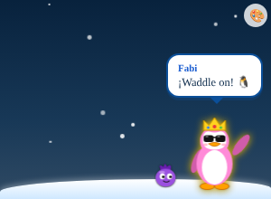
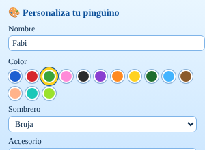
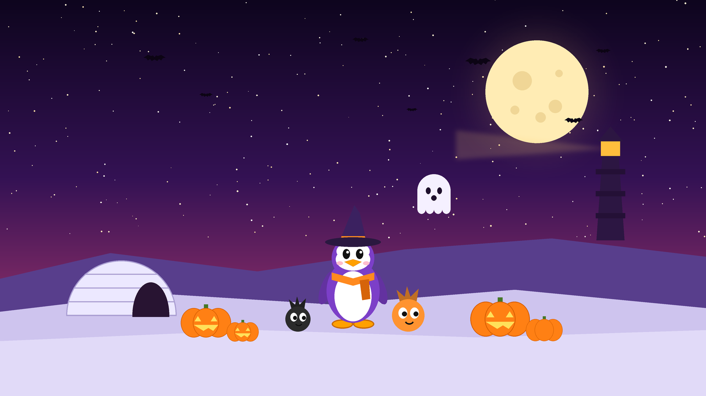

# 🐧 Club Penguin Isla: tema para tu PC

Proyecto de fans inspirado en Club Penguin. Incluye:

1. **Extensión para Visual Studio Code**
   - Tema de colores **"Club Penguin Isla"**: azul océano, nieve, monedas doradas y colores de puffles.
   - Un **pingüino y un puffle que caminan** por el panel *🐧 Club Penguin* del Explorador mientras programas (con nieve cayendo).
   - **Click al pingüino** → te dice una frase (¡puedes poner las tuyas!). **Click al puffle** → salta.
   - **Personalización** (botón 🎨): 14 colores de pingüino, sombreros (gorra con hélice, fiesta, corona, vikingo, gorro de lana, bruja, copa), accesorios (bufanda, corbatín, lentes, audífonos), nombre y color de puffle.
2. **Tema de Google Chrome versión Halloween 🎃**: noche morada, luna llena, murciélagos, faro embrujado, calabazas y un pingüino con sombrero de bruja en la página de nueva pestaña.

 



## Instalación

Descarga esta carpeta (`club-penguin-theme`) en tu PC y luego:

| Sistema | Cómo instalar |
|---|---|
| **Windows** | Doble clic en **`instalar.bat`** |
| macOS / Linux | `bash install.sh` |

El instalador:
- Instala la extensión en VS Code (`club-penguin-isla-1.0.0.vsix`). Al reiniciar VS Code, el tema se activa solo y tu pingüino aparece en el Explorador.
- Copia el tema de Chrome a una carpeta fija y abre `chrome://extensions`. Chrome no deja instalar temas automáticamente, así que hay que hacer este paso **una sola vez**:
  1. Activa **Modo de desarrollador** (arriba a la derecha).
  2. Clic en **Cargar extensión sin empaquetar**.
  3. Elige la carpeta (en Windows la ruta queda copiada en el portapapeles, solo pega con Ctrl+V).

> Para quitar el tema de Chrome: Configuración → Apariencia → Tema → *Restablecer a predeterminado*.

## Personalizar el pingüino

- Botón **🎨** en el panel del pingüino, o el ícono de bote de pintura en la barra del panel.
- Paleta de comandos (`Ctrl+Shift+P`) → **Club Penguin: Personalizar pingüino**.
- O directamente en `settings.json`:

```jsonc
"clubPenguin.name": "Pingüi",
"clubPenguin.color": "rosa",            // o un hex: "#ff00aa"
"clubPenguin.hat": "bruja",
"clubPenguin.accessory": "bufanda",
"clubPenguin.puffleColor": "morado",
"clubPenguin.speed": 1.5,
"clubPenguin.messages": ["¡Tú puedes!", "¿Ya hiciste commit?"]
```

> Tip: puedes arrastrar el panel *🐧 Club Penguin* al panel inferior (junto a la terminal) para que tenga más espacio para caminar.

## Para desarrolladores

```bash
python3 scripts/generate_images.py                      # regenera fondos e ícono (requiere Pillow)
cd vscode-extension && npx @vscode/vsce package --out ../club-penguin-isla-1.0.0.vsix
```

---
Proyecto hecho por fans, sin afiliación con Disney ni Club Penguin. Todo el arte está dibujado desde cero.
